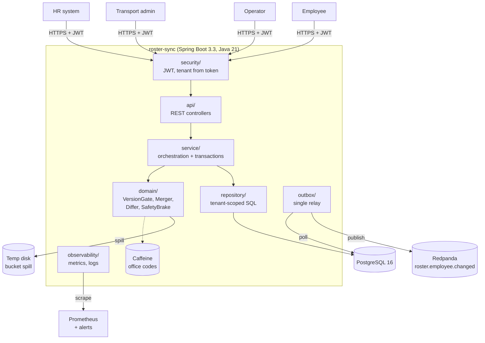

# HR Roster Sync

This service keeps MoveInSync's employee records correct while an HR system pushes changes that arrive twice, out of order, with bad data, or cut short. It is the solution to Case Study 5 (Advanced Track).

**GitHub repository:** [github.com/ArpitShukla3/a6](https://github.com/ArpitShukla3/a6)

Built with Java 21, Spring Boot 3.3, PostgreSQL 16, Redpanda (Kafka API), Micrometer/Prometheus and Testcontainers.

```bash
docker compose up --build     # postgres + redpanda + app + prometheus
./scripts/demo.sh             # walks through every main flow with curl (needs curl, jq, python3)
```

- App: http://localhost:8080
- Metrics: http://localhost:8080/actuator/prometheus
- Prometheus (with alert rules): http://localhost:9090

The design note, with the labelled data-flow diagram, the reconciliation sequence diagram and the failure-mode table, is in [docs/design-note.md](docs/design-note.md).

---

## Architecture at a glance



- **Write path:** request → validator chain → row lock → `VersionGate` → `EmployeeMerger` → employee row, outbox event and booking side effects, all in **one transaction per record**.
- **Nightly path:** the CSV is streamed to disk in hash buckets, digests are compared with the DB, only differing buckets are drilled into, and `SafetyBrake` decides whether the run applies or waits for an operator.
- **Out path:** the outbox relay publishes committed changes to Redpanda in order, keyed by employee.

---

## 1. What it does

| Requirement | How |
|---|---|
| Create / update / deactivate events with a source version | `POST /api/v1/roster/events`, up to 1,000 events per batch, each event carrying `sourceVersion` and `occurredAt` |
| Validate at the boundary; one bad record never fails a batch | A chain of validators (required fields, formats, phone via libphonenumber, office exists). Each record runs in its own transaction. The per-record report holds the **field name and code only**; it is also stored and served at `GET /api/v1/roster/batches/{id}/errors` |
| Per-employee version order; stale ignored; duplicate is a no-op | `VersionGate` runs under a row lock (`SELECT … FOR UPDATE`); see §4 |
| Field ownership | HR and the transport admin each own a separate set of fields, each with its own version counter. The written conflict rule is in §4 |
| Efficient nightly diff, bounded memory | The file is streamed once into 256 hash buckets on disk. Per-bucket digests are compared, and only differing buckets are compared row by row. Measured: **200k rows diffed in about 4 s, peak heap 163 MB, whole JVM capped at 256 MB** |
| Safety brake | The run is held when ≥ 30% of active employees are missing (configurable globally and per tenant), when the file is truncated, or when ≥ 5% of rows are rejected. A held run changes nothing until an operator approves or rejects it |
| Reliable change events | Transactional outbox. A single active relay publishes to Redpanda, keyed by employee, and waits for the broker's ack |
| Deactivation side effects | In the **same transaction** as the deactivation, future bookings are cancelled, seats freed, and a `BOOKING_CANCELLED` event is written |

---

## 2. Running

### One command

```bash
docker compose up --build
```

Compose starts PostgreSQL, Redpanda, the app (Flyway creates the schema and seeds two demo tenants with offices and seats) and Prometheus.

The demo stack enables `POST /dev/token`, which mints JWTs. In production, tokens come from the corporate IdP.

### Tests (no local JDK needed)

```bash
./scripts/run-tests.sh            # 89 tests: unit + integration (Testcontainers PostgreSQL)
./scripts/run-tests.sh -Pbench    # benchmarks, JVM capped at -Xmx256m
```

`scripts/mvn.sh` runs Maven inside `maven:3.9-eclipse-temurin-21`. If you have JDK 21 and Maven installed, `mvn test` works directly.

### Sample API calls

```bash
TOKEN=$(curl -s localhost:8080/dev/token -H 'Content-Type: application/json' \
  -d '{"tenantId":"11111111-1111-1111-1111-111111111111","roles":["HR_SYSTEM"]}' | jq -r .token)

# Real-time batch
curl -s localhost:8080/api/v1/roster/events -H "Authorization: Bearer $TOKEN" -H 'Content-Type: application/json' -d '{
  "batchId": "7d3c7c0e-9a0a-4c55-8f0e-2b1b0c9f1e01",
  "events": [{"type":"UPDATE","externalId":"E1001","sourceVersion":7,"occurredAt":"2026-10-29T09:00:00Z",
              "hr":{"name":"Asha Rao","email":"asha@acme.test","phone":"+919876543210",
                    "managerExternalId":"E0007","officeCode":"BLR-02","shiftCode":"S2"}}]}'

# Nightly snapshot (raw CSV body, streamed to disk; 202 + runId)
curl -s localhost:8080/api/v1/roster/snapshots -H "Authorization: Bearer $TOKEN" \
  -H 'Content-Type: text/csv' --data-binary @export.csv

# Operator: inspect a held run, then approve or reject it
curl -s localhost:8080/api/v1/reconciliation/runs/$RUN -H "Authorization: Bearer $OPS"
curl -s -X POST localhost:8080/api/v1/reconciliation/runs/$RUN/approve -H "Authorization: Bearer $OPS"
```

Snapshot file format (the header line and end line are required for truncation detection):

```
#ROSTER_EXPORT,as_of=2026-10-29T00:00:00Z,expected_rows=200000
external_id,source_version,name,email,phone,manager_external_id,office_code,shift_code
E1001,7,Asha Rao,asha@acme.test,+919876543210,E0007,BLR-02,S2
...
#END,rows=200000
```

### API

| Method | Path | Roles |
|---|---|---|
| POST | `/api/v1/roster/events` | HR_SYSTEM |
| POST | `/api/v1/roster/snapshots` | HR_SYSTEM |
| GET | `/api/v1/roster/batches/{batchOrRunId}/errors` | HR_SYSTEM, OPERATOR |
| GET | `/api/v1/reconciliation/runs`, `/runs/{id}` | OPERATOR, HR_SYSTEM |
| POST | `/api/v1/reconciliation/runs/{id}/approve` \| `reject` \| `retry` | OPERATOR |
| GET | `/api/v1/employees?page&size` | TRANSPORT_ADMIN, OPERATOR |
| GET | `/api/v1/employees/{externalId}` (ETag = admin version) | TRANSPORT_ADMIN, OPERATOR, EMPLOYEE (self only) |
| PATCH | `/api/v1/employees/{externalId}/transport` (requires `If-Match`) | TRANSPORT_ADMIN |
| GET | `/api/v1/employees/{externalId}/bookings` | TRANSPORT_ADMIN, EMPLOYEE (self only) |
| POST | `/api/v1/bookings` | TRANSPORT_ADMIN |
| GET / POST | `/api/v1/offices` | read: OPERATOR, TRANSPORT_ADMIN, HR_SYSTEM · write: OPERATOR |
| GET | `/actuator/health`, `/actuator/prometheus` | public |

---

## 3. Assumptions

1. Each HR event carries a **per-employee, increasing `sourceVersion`**. The nightly export uses the same version space. If HR only had timestamps, they would be converted to epoch microseconds plus a sequence.
2. CREATE and UPDATE events carry **all HR fields** (snapshot semantics, not deltas). This is what makes "ignore the stale v6" correct in the brief's example: v7 already contains the v7 shift.
3. HR owns: name, email, phone, manager, office, shift, and status. Shift isn't listed in the brief; it comes from the HR feed in the example, so HR owns it. The transport admin owns: pickup point and special assistance.
4. The export has a header (`as_of`, `expected_rows`) and an end line. A missing end line or a count mismatch means truncated.
5. `occurredAt` (on events) and `as_of` (on the export) come from the same HR clock. They are used only to decide whether an employee missing from the file changed after the export was cut.
6. An UPDATE does not change status. A newer CREATE reactivates (rehire). A DEACTIVATE for an unknown employee stores a tombstone.
7. Bookings and seats are modelled only as far as needed to prove the deactivation side effects.

---

## 4. Ordering, idempotency and ownership rules

**Idempotency key:** `(tenant_id, external_id, sourceVersion)`.

**Version comparison** (incoming `v`, stored `s`), decided by `VersionGate` while the row is locked:

| Case | Outcome |
|---|---|
| Unknown employee | APPLIED (insert) |
| `v < s` | STALE: ignored, counted |
| `v > s` | APPLIED |
| `v == s`, and the event would produce exactly the stored state | DUPLICATE: no-op, no event |
| `v == s`, stored was deactivated **by reconciliation**, event is a create, update or snapshot row | APPLIED (reactivate) |
| `v == s`, different content | CONFLICT: rejected with `VERSION_CONFLICT`; the source sent two different records at one version, so we don't guess |

**Field ownership (conflict rule):**
1. Only HR events write HR fields, ordered by `hr_version`.
2. Only `PATCH …/transport` writes transport fields, with optimistic locking on `admin_version` (`If-Match`; `428` if the header is missing, `412` if stale). The two version counters are independent, so neither side can make the other's change "stale".
3. Transport fields found in an HR payload are dropped. The record is still applied, with a `FIELD_OWNED_BY_TRANSPORT` warning, and `roster_ownership_violations_total` is incremented.
4. When HR changes the office of someone who has a pickup point, the pickup point is **kept** and flagged with `pickupNeedsReview`, and a `PICKUP_REVIEW_REQUIRED` event is written. HR never clears it; the admin's next edit clears the flag.

**Nightly reconciliation rules:**
- File rows go through the **same** versioned path as API events, so the file can never roll back a newer real-time change.
- A missing employee is deactivated only if all of these hold:
  - they were a candidate at diff time (and so counted by the brake or approved by the operator);
  - they are still active;
  - their `hr_version` is unchanged since the diff;
  - their last HR change happened **before** the export's `as_of`. Someone who joined after the export was cut is never deactivated.
- A reconciliation deactivation does **not** bump `hr_version`, because that version belongs to HR. It is marked `deactivated_by=RECONCILIATION`, so any HR record at the same or a newer version brings the employee back.
- A rejected row whose employee ID can be read counts as **present**. A broken row is not evidence that someone left.

---

## 5. Benchmarks

Machine: Intel Core i5-1240P (12 cores / 16 threads), 15 GB RAM, Fedora Linux 7.2 kernel, Docker 29.8. OpenJDK 21.0.12 in `maven:3.9-eclipse-temurin-21`; PostgreSQL 16 in a container on the same laptop. JVM heap capped at **256 MB** for the whole application. Raw output is in [docs/bench-results.md](docs/bench-results.md).

**Nightly diff: 200,000-row export vs 200,000 stored employees** (1% changed, 0.5% new, 0.5% missing)

| Phase | Result |
|---|---|
| Diff: stream + bucket spill + digests + drill-down | **4.1 s** (target < 60 s) |
| Total, including applying 2,000 updates, 1,000 creates and 1,000 deactivations | 9.8 s |
| Peak heap, whole JVM | 163 MB of 256 MB |
| Export cut at row 120,000 of 200,000 | HELD (`MISSING_RATIO,TRUNCATED_FILE`), 80,600 appear missing, **0 deactivated**, 5.0 s |

**Real-time ingest over HTTP** (16 concurrent clients, batches of 100; 64,000 events, half creates, half updates of which 10% are stale)

| Metric | Value |
|---|---|
| Throughput | 2,265 events/s |
| Request (100 events) latency p50 / p95 / p99 | 858 / 1,294 / 1,388 ms |
| Server-side apply per event p50 / p99 | 7.1 / 21.0 ms |

---

## 6. Cost: time, space, and where it stops scaling

| Operation | Time | Space |
|---|---|---|
| Apply one event | O(log N) index lookup + 2–3 row writes, in one transaction | O(1) |
| Batch of k events | O(k log N), k transactions | O(k) for the response |
| Nightly diff (N rows, B = 256 buckets, d differing buckets) | O(N) file read + O(N) streamed DB scan + O(d · N/B) drill-down | Heap O(B + N/B) (one bucket at a time); disk O(N) for the spill |
| Outbox relay pass | O(batch) via a partial index on unpublished rows | O(batch) |

Where it stops scaling:
- **Ingest throughput.** Ingest is bounded by one PostgreSQL primary and one transaction per record: about 2.3k events/s on this laptop. Batching several records into one transaction would roughly double that, at the cost of per-record isolation.
- **Relay.** One relay publishes events one by one and waits for each ack, which keeps order simple. Its ceiling is in the low thousands of events/s. The next steps are pipelined sends per partition, or CDC (Debezium) on the WAL.
- **Diff.** The diff is linear, and wall time is dominated by reading the file and the DB scan. Around 10M employees per tenant, raise the bucket count or add a second digest level; spill disk grows linearly with N.
- **Hot employee.** Updates to one employee are serialized by the row lock. That's fine at HR change rates.

---

## 7. Trade-offs

- **Consistency over availability on the write path.** Each employee is strongly consistent: a single DB, a row lock, and the version gate. If PostgreSQL is down, ingest returns `503` and HR retries, which is safe because every operation is idempotent. Downstream consumers are eventually consistent: outbox lag is under a second normally and visible as `roster_outbox_oldest_age_seconds`.
- **Synchronous per-record apply.** Ingest has no inbound queue. HR gets a definitive per-record answer in the response, at the cost of throughput under bursts.
- **The brake holds the whole run**, not just the deactivations. A broken file is suspect as a whole, and the real-time feed keeps flowing meanwhile. The cost is that legitimate changes in that file wait for an operator.
- **Same version with different content is rejected**, not tie-broken. We favour correctness over the availability of that one record.
- **Side effects are synchronous** (same transaction) rather than a Kafka consumer. Bookings live in the same database, so a broker outage can never leave an exited employee holding a seat.
- **Ordering beats throughput in the relay.** A single active relay (advisory lock), head-of-line blocking on failure, and exponential backoff. One poison event delays everything behind it; it shows up in `roster_outbox_publish_failures_total` and in the lag alert.
- **No read cache for employees.** Reads hit the DB, so nothing about an employee's status or versions is ever stale. Only office codes are cached (§9).

**Deliberately left out:**
- **Row-level security (RLS) in PostgreSQL.** Tenant isolation is enforced by taking the tenant from the token and adding a `tenant_id` filter to every query, and tests prove it. RLS would be a second layer.
- **A real IdP** (Keycloak or similar); the demo token endpoint stands in for it.
- **Per-field versioning; encrypting PII columns at rest; multi-region; exactly-once delivery** (consumers dedupe by `eventId` instead).
- **A consumer service** (only the publish side is in scope).
- **An operator UI** (the API covers the operator flow).
- **Leader election for reconciliation workers.** Resuming in-flight runs on startup assumes one worker; with several instances it would take an advisory lock per tenant.

---

## 8. Monitoring

These are the metrics at `/actuator/prometheus` (alert rules are in `prometheus/alerts.yml`):

| What on-call needs at 3 AM | Metric |
|---|---|
| Error rate / rejections | `roster_ingest_events_total{outcome=APPLIED\|STALE\|DUPLICATE\|CONFLICT\|REJECTED\|FAILED}`, `roster_ingest_rejections_total{code}` |
| Queue depth | `roster_outbox_pending` |
| Lag | `roster_outbox_oldest_age_seconds` (publish lag), `roster_ingest_lag_seconds` (source event → applied) |
| Retries | `roster_outbox_publish_failures_total` (each one is retried with backoff) |
| Safety brake | `roster_reconciliation_held_runs`, `roster_reconciliation_brake_tripped_total{reason}`, `roster_reconciliation_last_missing_ratio` |
| Latency | `roster_ingest_apply_seconds` (p50/p99 + histogram), `roster_reconciliation_diff_seconds` |
| Side effects / ownership | `roster_bookings_cancelled_total`, `roster_ownership_violations_total`, `roster_change_events_total{type}` |
| Cache | `cache_gets_total{cache="officeCodes",result}`, `cache_evictions_total` |

Logs are JSON (logstash encoder). Every line carries `correlationId` (echoed in the `X-Correlation-Id` header and in every error body), plus `tenantId` and `principal`. A safety-brake trip logs one `WARN` line with the run ID, the counts and the reasons.

---

## 9. Caching

| Cache | What | Policy | What can be stale, and how long |
|---|---|---|---|
| `officeCodes` (Caffeine) | tenant → set of office codes; read on every ingested record | expire 5 min after write, max 10,000 tenants, W-TinyLFU eviction | A newly added office can be unknown to **another** app instance for at most 5 minutes; the local instance evicts on write. The effect is a retryable `OFFICE_UNKNOWN` rejection, never a wrong write. Bound proven by `OfficeDirectoryCacheTest` with a fake clock. |

Never cached: employee rows, versions, status (booking eligibility) and reconciliation inputs.

---

## 10. Errors and personal data

- Every error is `application/problem+json` with a stable `code` and the `correlationId`. Messages are fixed texts; submitted values, SQL errors and stack traces never reach a client.
- Validation errors are `{field, code}` only.
- Logs carry IDs (employeeId, externalId, runId, batchId), never names, emails, phones or addresses. Several mechanisms enforce this:
  - The value objects' `toString()` methods redact personal data.
  - Only exception class names are logged, because driver messages can contain values.
  - Outbox payloads list changed **field names**, not values.
- `PiiLeakIT` drives the main flows, including a crash, with recognisable personal data and asserts that none of it appears in the logs, the error responses, or the outbox payloads.

---

## 11. Every hard rule has a test

| Rule | Test |
|---|---|
| Stale update ignored (brief's v7/v6 example) | `IngestIT.briefExample_transferV7BeforeShiftChangeV6`, `VersionGateTest` |
| Replaying the same feed twice changes nothing | `IngestIT.replayingTheSameFeedTwiceChangesNothing`, `ReconciliationIT.replayingTheSameFileChangesNothing` |
| One bad record never fails the batch | `IngestIT.oneBadRecordNeverFailsTheBatch`, `ApiSecurityIT.batchEndpointReportsPerRecord_…` |
| HR never overwrites transport fields | `IngestIT.hrUpdateNeverOverwritesTransportOwnedFields`, `EmployeeMergerTest` |
| Diff with bounded memory, < 60 s for 200k rows | `SnapshotDiffBenchmark` (asserts < 60 s with `-Xmx256m`), `BucketedSnapshotDifferTest` |
| Brake: ≥ 30%, configurable, truncated file → nobody deactivated, operator sees missing count | `SafetyBrakeTest`, `ReconciliationIT.briefExample_fileCutOff_…`, `…thresholdIsConfigurablePerTenant`, `SnapshotDiffBenchmark.briefExample_120kOf200kFileIsHeld` |
| Operator approval / rejection | `ReconciliationIT.operatorApprovalAppliesHeldDeactivations_…`, `ApiSecurityIT.snapshotUploadAndOperatorFlowOverHttp` |
| Outbox: crash between DB write and publish | `OutboxFailureIT.crashBetweenDatabaseWriteAndPublish_…`, `…crashAfterPublishBeforeMark_…`, `…crashInsideTheIngestTransaction_…` |
| Deactivation cancels bookings and frees seats | `IngestIT.deactivationCancelsFutureBookingsAndFreesSeats`, `ReconciliationIT.normalNight_…` |
| **Concurrency** | `ConcurrencyIT`: 50 shuffled versions in parallel; 8 racing creates; booking vs deactivation race (×5) |
| **Failure injection** | `OutboxFailureIT` (5 scenarios incl. broker outage), `ReconciliationIT.crashMidApply_retryCompletesWithoutDuplicateEvents` |
| Tenant isolation / roles | `ApiSecurityIT` (401, 403, cross-tenant 404, employee self-only) |
| No PII in logs or errors | `PiiLeakIT`, `ValidationTest.errorsNeverContainTheRejectedValue` |
| Cache staleness bound | `OfficeDirectoryCacheTest` |

---

## 12. Code layout

```
src/main/java/com/moveinsync/roster/
├── domain/            plain Java, no Spring or DB (unit-tested directly)
│   ├── event/         RosterEvent (sealed) → Create / Update / Deactivate / SnapshotRow events
│   ├── policy/        VersionGate, EmployeeMerger, FieldOwnershipPolicy
│   ├── validation/    RecordValidator chain (required, format, phone, office)
│   └── reconcile/     SnapshotReader, BucketSpill, BucketedSnapshotDiffer, SafetyBrake + BrakeRules
├── service/           transactions & orchestration (ingest, reconciliation, transport, bookings)
├── repository/        SQL via JdbcClient, always tenant-scoped
├── outbox/            relay, Kafka / logging publishers, gauges
├── api/               controllers, DTOs, RFC 7807 error handler
├── security/          JWT resource server, roles, CurrentUser (tenant from token)
├── observability/     metrics, correlation-id + tenant MDC filters
└── fault/             FaultInjector (test hook points)
```

## 13. Changes from the plan after review

- **Write path.** It locks the row, decides in Java and then writes, instead of one conditional upsert. This lets the core decision be unit-tested and gives the merge access to the old row (changed fields, office-change detection).
- **Bucket digests.** They are a wrapping **sum plus a count**, computed in Java on both sides, instead of `bit_xor` in SQL. XOR would let duplicate rows cancel out, and the database would otherwise have to reproduce Java's hash.
- **Deactivation side effects.** They are synchronous in the same transaction instead of running in a Kafka consumer.
- **Relay.** It is a single active relay with head-of-line blocking, instead of several `SKIP LOCKED` relays, which could reorder one employee's events.
- **Reconciliation deactivations.** They don't bump the HR version, and they can be undone (§4).
- **Rejected rows.** A rejected row with a readable ID counts as present, and a third brake rule trips on the rejection rate.
- **Cut** from the plan: the employee read cache, Postgres RLS, the absolute-cap brake rule, Postman and k6. A Java HTTP load benchmark replaces k6.
