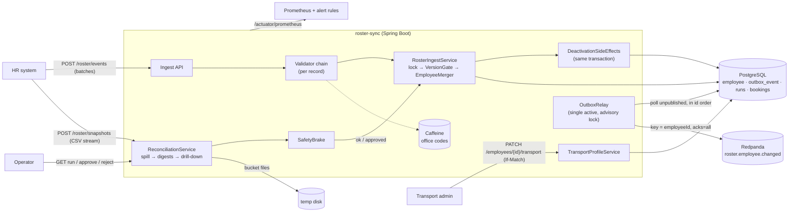
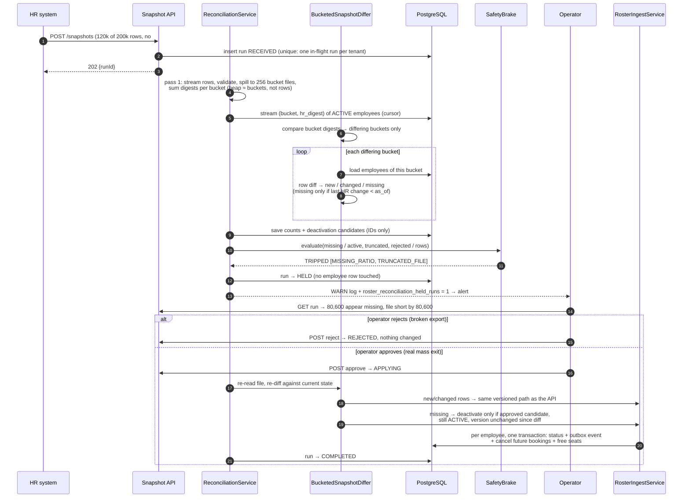

# Design Note: HR Roster Sync

## 1. Architecture

**Layers.**
- **Controllers** handle HTTP and auth only.
- **Services** own the transactions.
- **Repositories** are explicit SQL, always scoped by tenant.
- **Domain** (`domain/**`) is plain Java with no Spring or database: `VersionGate`, `EmployeeMerger`, the validators, `BucketedSnapshotDiffer` and `SafetyBrake`. These are unit-tested in milliseconds.

**Data model (main tables).**
- `employee`: HR fields, `hr_version`, `hr_digest`, `hr_source_ts`, `bucket`, `status`, `deactivated_by`, plus transport fields with their own `admin_version`.
- `outbox_event`: written in the change's transaction.
- `ingest_rejection`: field + code per record, never values.
- `reconciliation_run` and `reconciliation_candidate`.
- `booking` and `seat`.

## 2. The hardest flow: a nightly export that has been cut short

Why the apply phase re-reads the file instead of applying a stored diff:
- It sees any real-time changes that landed while the run was held, so nothing stale is written.
- Every step is idempotent, so a crash mid-apply is fixed by **retry** (`POST /runs/{id}/retry`, or automatically on restart).

## 3. Failure modes

| What fails | What the user sees | How the system recovers |
|---|---|---|
| Same event delivered twice | `DUPLICATE` in the per-record result; no change, no event | `VersionGate`: same version and same resulting state |
| Events out of order | Older one reported `STALE` | Version comparison under a row lock; events carry full HR state, so nothing is lost |
| Same version, different data | `CONFLICT` / `VERSION_CONFLICT` for that record | Rejected and counted; source must resend with a new version |
| Malformed record or unknown office | That record `REJECTED` with `{field, code}`; the rest applied | Validation before any write; one transaction per record |
| HR client times out and resends the batch | Already-applied records come back `DUPLICATE`/`STALE` | Idempotent apply |
| Two writers update one employee concurrently | Both get a correct answer; final state = highest version | `SELECT … FOR UPDATE`; insert races resolved by `ON CONFLICT DO NOTHING` + retry |
| Crash inside the ingest transaction | Record `FAILED` (retryable) | Row change, outbox event and side effects roll back together |
| Crash after commit, before publish | Event published a moment later | The committed outbox row is picked up by the next relay pass (any instance) |
| Crash after publish, before marking published | Consumer receives the event twice | Same `eventId` → consumer dedupes (at-least-once) |
| Broker down | Ingest unaffected; `roster_outbox_pending` and lag grow; alert after 60 s | Relay retries with exponential backoff (max 30 s), keeps order, drains on recovery (measured: about 8 s) |
| PostgreSQL down | `503 DEPENDENCY_UNAVAILABLE`; health DOWN | HR retries; nothing is half-written |
| Nightly file cut short, or 30%+ of employees missing | Run `HELD`; operator sees missing count, file shortfall, sample IDs; alert fires | Nobody deactivated until approve; reject discards the file |
| Many bad rows in the file | Run `HELD` (`REJECTED_RATIO`); per-row errors in the report | Bad rows with a readable ID count as present, never "missing" |
| Employee joins after export was cut | Not deactivated | Missing only counts if the last HR change is before `as_of` |
| Crash during reconciliation apply | Run `FAILED` (or stays `APPLYING` after a process kill) | `retry`, or auto-resume on startup; re-diff skips what was already applied, so no duplicate events |
| Booking created while the employee is being deactivated | Booking rejected `EMPLOYEE_INACTIVE`, or created and then cancelled | Booking takes a shared lock on the employee row |
| Token for tenant A used on tenant B data | `404` (existence not revealed) | Tenant taken only from the JWT; every query filters by it |
| New office added on another instance | Up to 5 min of retryable `OFFICE_UNKNOWN` | Cache TTL bound; evicted immediately on the local instance |

## 4. Key decisions

- **Idempotency key** is `(tenant, externalId, sourceVersion)`. Comparison: `v < s` stale, `v > s` apply, `v == s` duplicate if identical, otherwise conflict.
- **Two independent version counters** (HR and transport admin). This is what makes field ownership enforceable and keeps an HR replay from overwriting an admin edit.
- **Nightly deactivation is reversible evidence**, not an HR decision. It doesn't bump the HR version, and any HR record at the same or a newer version brings the employee back.
- **Outbox with one active relay.** Global id order, so per-employee order holds across instances. Order wins over raw throughput.
