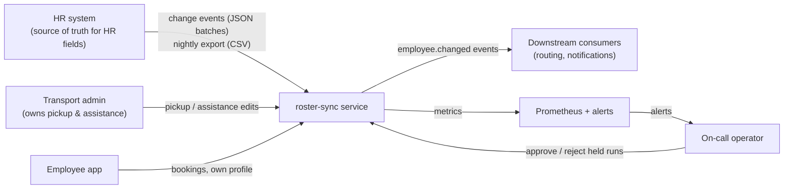
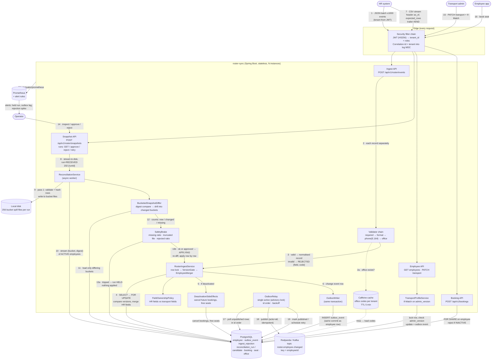
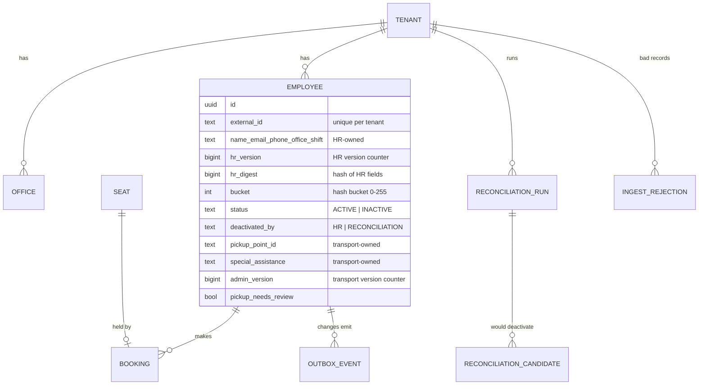
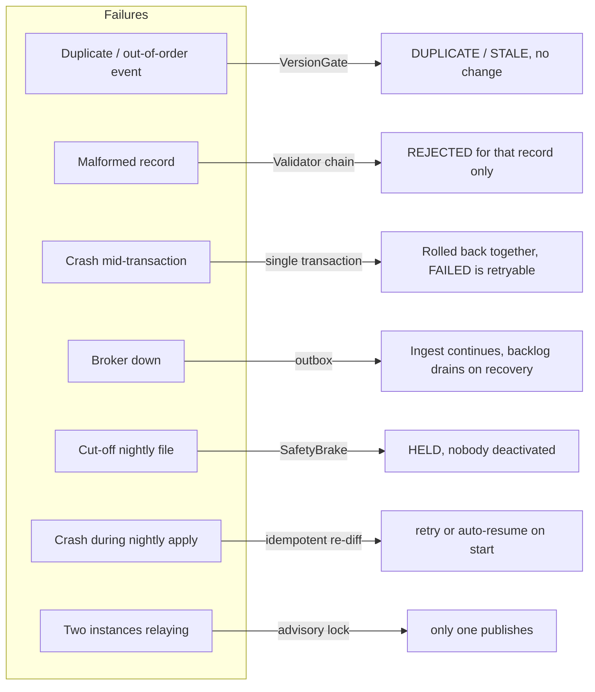
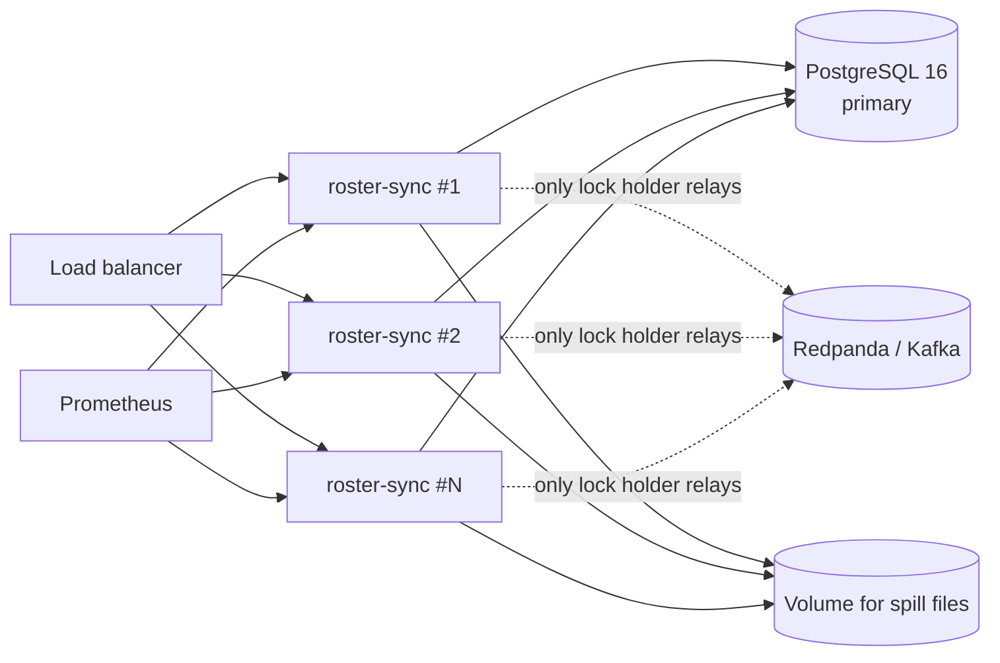

# High-Level Design: HR Roster Sync

This document covers four things:
- the system's main parts and how they connect;
- how data flows through them, with every arrow numbered and labelled with what moves and what is done to it;
- the architectural trade-offs behind each choice;
- how the system fails and recovers.

Lower-level details (state machine, sequence of the cut-off export flow, full failure table) are in [design-note.md](design-note.md). How to run it is in the [README](../README.md).

---

## 1. Problem in one paragraph

An HR system is the source of truth for employees: who works here, which office, which shift, and how to contact them. The transport platform needs an accurate copy of this data to plan cabs. Seat bookings and pickup points also depend on it.

HR sends data in two ways:
1. **Real-time change events.** These may be duplicated, arrive out of order, or contain malformed records.
2. **A nightly full export.** This can be up to 200k rows and may be cut off part way through.

The service must:
- apply both safely, so the result is idempotent and the newest version wins;
- never let a broken export deactivate real employees;
- protect fields owned by the transport admin from being overwritten by HR;
- trigger side effects when someone leaves (cancel bookings, free seats);
- tell downstream systems about every change reliably;
- keep tenants isolated and keep personal data out of logs.

---

## 2. System context

---

## 3. High-level architecture (the main diagram)

The numbers on the arrows match the steps in section 4.

### Legend

| Notation | Meaning |
|---|---|
| Solid arrow | Synchronous call or write on the request path |
| Dotted arrow | Lookup or cache read |
| `FOR UPDATE` / `FOR SHARE` | Postgres row locks, used to serialise writers on one employee |
| "same commit" | Written inside one DB transaction: either all of it happens or none of it does |

---

## 4. Data flows, step by step

### 4.1 Real-time change events (steps 1–6)

| Step | Data moving | Action taken | Why |
|---|---|---|---|
| 1 | JSON batch of up to 1,000 events (`CREATE` / `UPDATE` / `DEACTIVATE`) | JWT checked. The tenant is taken from the token, never from the body. | A caller can't write into another tenant. |
| 2 | One raw JSON node per event | Each record is parsed and validated on its own. One malformed event never fails the whole batch. | The brief requires a per-record error report. |
| 2a | Office code | Checked against a Caffeine cache of the tenant's office codes. | Avoids a DB query per record. Offices change rarely. |
| 3 | Normalised record (phone in E.164, trimmed fields) or `{field, code}` error | Invalid records are stored in `ingest_rejection` (field and error code only, never the value) and reported back. | Keeps personal data out of error storage. |
| 4 | `(tenant, externalId, sourceVersion, HR fields)` | Lock the employee row, then apply `VersionGate`: older → `STALE`; same version and same result → `DUPLICATE`; same version but different data → `CONFLICT`; newer → merge HR fields. Transport fields in an HR payload are dropped with a warning. | Idempotent and order-safe. Events carry the full set of HR fields, so the newest one is enough and nothing is lost when older ones are skipped. |
| 5 | Deactivation | Future bookings cancelled and seats freed, in the same transaction. | No booking can be left on an inactive employee. |
| 6 | Change event (IDs and changed field names only) | Inserted into `outbox_event` in the same commit as the employee change. | Every change produces an event, and an event is never sent for a change that rolled back. |

Response: per-record outcome (`APPLIED`, `STALE`, `DUPLICATE`, `CONFLICT`, `REJECTED` or `FAILED`) plus a summary.

### 4.2 Nightly full export (steps 7–14)

| Step | Data moving | Action taken | Why |
|---|---|---|---|
| 7 | CSV stream (header `as_of`, `expected_rows`; trailer `#END,rows=N`) | Accepted as a raw stream. A unique index allows only one in-flight run per tenant. | Two nightly runs for one tenant must never overlap. |
| 8 | File → disk | Run saved as `RECEIVED`; `202 {runId}` returned immediately. | 200k rows shouldn't hold an HTTP request open. |
| 9 | Each row → `hash(externalId + HR fields)` → bucket 0–255 | Row validated and written to its bucket's spill file. Per bucket, a digest (sum of hashes) and a count are kept. | Memory depends on the number of buckets, not rows: 163 MB peak at 200k rows. |
| 10 | `(bucket, hr_digest)` for ACTIVE employees | Streamed from Postgres with a cursor and summed per bucket. | Same summary on both sides, cheap to compare. |
| 11 | Only buckets whose digest or count differ | Load just those employees and compare row by row → new / changed / missing. | On a normal night few buckets differ, so most of the data is never compared row by row. |
| 12 | Counts and missing candidate IDs | Stored on the run (IDs only). | The operator can see who would be deactivated. |
| 13a | Brake tripped (≥30% missing, no `#END` trailer, or ≥5% rejected rows) | Run → `HELD`. **No employee row is touched.** Metric and alert fire. | A cut-off export looks exactly like a mass exit. Only a human can tell them apart. |
| 13b | Not tripped, or approved | Run → `APPLYING`. Re-read the file, re-diff against the **current** state, and apply through the same `RosterIngestService` as real-time events. A missing employee is deactivated only if: they were a candidate, are still ACTIVE, their version hasn't changed since the diff, and their last HR change is older than `as_of`. | Real-time changes that landed while the run was held are never overwritten. One write path means one set of rules. |
| 14 | Operator decision | `approve` → apply, `reject` → discard the file, `retry` → resume a failed apply. | Every step is idempotent, so a retry is always safe. |

### 4.3 Transport admin edit (step 15)

1. The admin sends `PATCH /employees/{id}/transport` with `If-Match: <admin_version>`.
2. The service locks the row and compares `admin_version`:
   - a stale version → `412`;
   - a missing header → `428`.
3. On success it updates the pickup point and special assistance, bumps `admin_version` and writes an outbox event.
4. HR fields and transport fields use **separate version counters**, so an HR replay can never overwrite an admin edit, and an admin edit never conflicts with HR's version.

If HR moves an employee to a new office, the pickup point is kept but flagged `pickup_needs_review`, and a `PICKUP_REVIEW_REQUIRED` event is emitted. The admin decides the new pickup point; HR doesn't.

### 4.4 Booking (step 16)

Creating a booking takes a `FOR SHARE` lock on the employee row. A deactivation takes `FOR UPDATE` on the same row, so the two are serialised. There are only two possible results:
- the booking is rejected with `EMPLOYEE_INACTIVE`; or
- it is created first and then cancelled by the deactivation.

A live booking on an inactive employee is impossible.

### 4.5 Outbox relay to Kafka (steps 17–19)

1. Each poll (every 200 ms), an instance tries `pg_try_advisory_xact_lock`. Only the instance holding the lock relays, so exactly one relay is active across N instances.
2. It reads unpublished rows in `id` order, up to 500 at a time.
3. It publishes them to `roster.employee.changed` with key `employeeId`, `acks=all` and an idempotent producer.
4. It marks the rows published. On failure it stops at the first failed row (head-of-line) and schedules a retry with exponential backoff, capped at 30 s.

Delivery guarantee: **at least once, in order per employee**. Consumers dedupe by `eventId`.

### 4.6 Observability (step 20)

| What | Details |
|---|---|
| Counters | Ingest outcome per source, rejections per code, brake trips per reason |
| Gauges | Held runs, outbox pending count, age of the oldest pending event |
| Logs | JSON, carrying correlation id, tenant id and employee id, with no personal data |
| Alert rules | Safety brake tripped; outbox lag over 60 s (for 2 min); outbox publish failures; rejection rate high; ingest failures |

---

## 5. Data ownership and storage

| Data | Owner | Version field | Who can change it |
|---|---|---|---|
| name, email, phone, office, shift, status | HR | `hr_version` | HR events, nightly export |
| pickup point, special assistance | Transport admin | `admin_version` | `PATCH …/transport` only |
| `deactivated_by = RECONCILIATION` | System | (no bump) | Nightly run. Reversed by any HR record at the same or a newer version. |

---

## 6. Architectural trade-offs

| # | Decision | Chosen | Alternative considered | Why chosen | Cost we accept |
|---|---|---|---|---|---|
| 1 | Ordering and idempotency | Per-employee `sourceVersion` compared under a row lock | Event-ID dedupe table; ordering by timestamp | Handles duplicates **and** reordering with one rule. Timestamps from HR can't be trusted to be ordered. | HR must send a version that only goes up per employee. Same version with different data has to be rejected as `CONFLICT`. |
| 2 | Event content | Full set of HR fields per event (snapshot) | Field-level deltas | Skipping an older event loses nothing. Replays are naturally idempotent. | Bigger payloads. A partial update has to resend all HR fields. |
| 3 | Concurrency control | Pessimistic `SELECT … FOR UPDATE` per employee | Optimistic retry loop; single-writer queue per employee | Simple and correct with N instances. Contention is per employee, so it's rare. | Holds a DB lock for the length of one small transaction. |
| 4 | Batch failure handling | One transaction per record, with a per-record report | One transaction per batch | One bad record doesn't block 999 good ones, as the brief requires. | More commits per batch (measured: ~2,300 events/s, fine for HR volumes). |
| 5 | Event publishing | Transactional outbox + relay | Publish to Kafka directly in the request | No lost or phantom events. Ingest keeps working while the broker is down. | Extra table and poller. Delivery is at least once, so consumers must dedupe. Adds ~200 ms of latency. |
| 6 | Relay topology | One active relay (advisory lock), global id order | Partitioned relays, or CDC (Debezium) | Keeps per-employee order across instances without extra infrastructure. | Throughput is capped by one relay; head-of-line blocking on a failed event. CDC is the next step at scale. |
| 7 | Nightly diff | Hash buckets, spilled to disk; drill only into changed buckets | Load the whole file into memory; temp table + SQL `EXCEPT` | Memory depends on bucket count, not row count. Unchanged buckets are skipped. Runs in 4 s for 200k rows. | Temp disk is needed. Hash collisions are possible in principle (64-bit hash, negligible). |
| 8 | Bulk deactivation | Safety brake → `HELD` → human approval | Always apply; fixed max-deactivation count | A cut-off export can't be told apart from a mass exit automatically. Better to delay than to wrongly deactivate thousands. | A real mass exit needs an operator click. The thresholds (30% / 5%) need tuning per tenant (supported via `tenant.brake_missing_ratio`). |
| 9 | Applying an approved run | Re-read the file and re-diff against current state | Apply the diff saved at diff time | Real-time changes made while the run was held win. Apply is idempotent, so a crash mid-way is safe to retry. | Reads the file twice. |
| 10 | Field ownership | Two version counters and an ownership policy | One version for the whole row; last-write-wins | HR and the admin never overwrite each other's data. | More columns and an `If-Match` contract for admin clients. |
| 11 | Booking side effects | Synchronous, in the deactivation transaction | Async consumer of the deactivation event | Never leaves a live booking on an inactive employee. | Deactivation transactions are a bit longer. Booking logic lives in the same service. |
| 12 | Office lookup | Local Caffeine cache, 5-minute TTL, evicted after commit on the writing instance | No cache; distributed cache (Redis) | Cuts a DB hit per record. No extra infrastructure. | Another instance may reject a brand-new office for up to 5 minutes with a retryable `OFFICE_UNKNOWN`. |
| 13 | Tenant isolation | Tenant from the JWT; every query filtered by `tenant_id`; cross-tenant access returns 404 | Postgres row-level security; schema or DB per tenant | Simple and covered by tests. | Relies on code discipline. Row-level security is the recommended hardening step. |
| 14 | Data access | Plain SQL (`JdbcClient`) | JPA/Hibernate | Exact control over locks, `ON CONFLICT` and streaming cursors. | More hand-written SQL. |
| 15 | PII safety | IDs only in logs, events and rejections; redacted `toString`; enforced by a test | Masking at the log appender | Data never reaches a log in the first place. | Debugging needs a lookup by ID. |

---

## 7. Failure handling at a glance

All of these were verified by integration tests or the live demo:
- **Broker outage:** stopped for a while, 50 events queued, drained about 8 s after restart.
- **Cut-off export:** 600 of 1,000 rows sent, the run was held and 0 people were deactivated.

---

## 8. Deployment view

- **App instances are stateless.** Only the nightly spill files sit on disk, and a run resumes from the stored file.
- **Scaling path** as volume grows:
  1. Read replicas for `GET` endpoints.
  2. Partition `outbox_event` by time.
  3. Replace the poller with CDC.
  4. Shard reconciliation by bucket ranges across workers.
  5. Add Postgres row-level security for tenant isolation.
- **Local stack:** `docker compose up --build` starts Postgres, Redpanda, the app and Prometheus.
